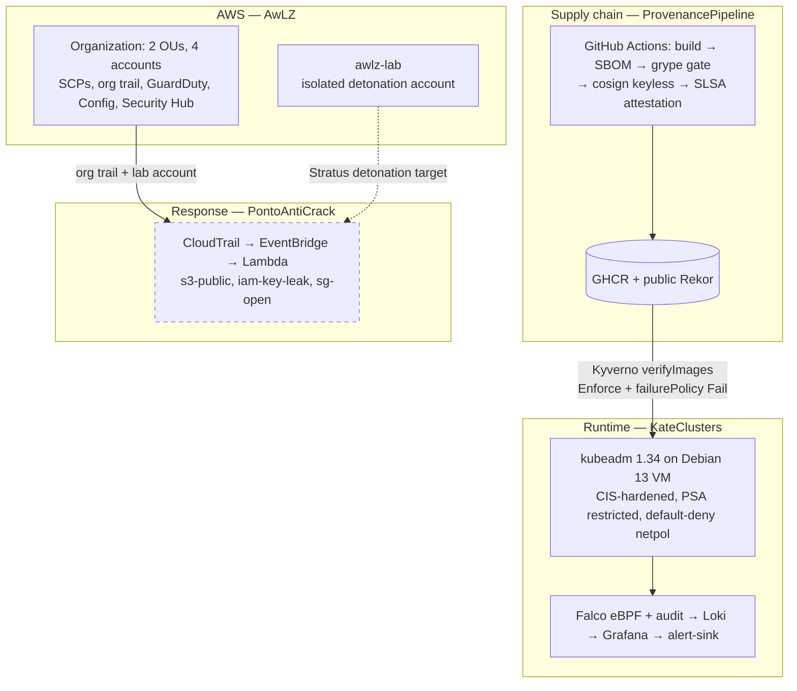

# TrustStack

Portfolio handbook. Written 2026-07-30, from the repositories as they actually stand — every
number below was read out of a repo or a command, not carried over from a previous document.

Four repositories, one thesis. Owner: Pedro (GitHub `PontoPe`).

---

## 1. The thesis

Each repo builds a layer of trust in a system, and each one **proves its own claims rather
than asserting them**.

| Layer | Question it answers | Repo |
|---|---|---|
| Cloud governance | Can an account do something nobody watches? | **AwLZ** |
| Artifact provenance | Do I know where this container came from? | **ProvenancePipeline** |
| Runtime | If something breaks in, does anyone find out? | **KateClusters** |
| Response | When something is found, what happens automatically? | **PontoAntiCrack** |

The unifying rule, and the reason this reads differently from a tutorial portfolio:

> **The deliverable is not working infrastructure. It is reproducible infrastructure plus
> evidence that the controls do what the documentation claims — including where they don't.**

Every repo has a `docs/evidence/` directory. Three of the four have real artefacts in it. The
fourth is empty **on purpose**, because nothing has been proven there yet, and it says so.

## 2. Status

| | Commits | Repo | Code | Proven against reality | Evidence |
|---|---:|---|---|---|---|
| **AwLZ** | 41 | public | 6 stacks applied to a live AWS org | ✅ SCPs probed, org trail delivering, 5 Config recorders | 3 verification docs |
| **ProvenancePipeline** | 22 | public | CI + admission enforcement | ✅ signed image, attestations, Rekor, **4-case admission demo recorded** | 2 generated docs + GIF |
| **KateClusters** | 30 | private | cluster built + hardened | ✅ CIS 12 FAIL → 0, 4 attack sims with real alerts | 2 kube-bench JSONs |
| **PontoAntiCrack** | 16 | private | 3 detections, 167 tests | ❌ never applied, nothing detonated | empty, correctly |

52 ADRs across the four. Every scanner suppression carries a written justification.

## 3. How they interlock



Two real dependencies, and both are one-directional:

1. **PontoAntiCrack consumes AwLZ.** The org trail it reads and the lab account it detonates
   in are both AwLZ resources. It cannot be meaningfully built before AwLZ's logging exists —
   and AwLZ's logging does exist, so PAC is unblocked as of now.
2. **ProvenancePipeline enforces on KateClusters.** The Kyverno policy belongs to
   ProvenancePipeline; the cluster it admits into belongs to KateClusters. That integration
   is complete: one signed image is admitted and three deny paths are recorded.

Nothing else couples. AwLZ and KateClusters were built in parallel on purpose — one waits on
AWS, the other never touches it.

---

## 4. Per project

### AwLZ — AWS Landing Zone

**Live.** Six stacks applied against a real organization: `bootstrap`, `org-root`,
`guardrails`, `logging`, `detection`, `ci-oidc`. Home region `sa-east-1`, `us-east-1` also
permitted because global services report there regardless.

- 2 OUs, 4 member accounts, **root credentials deleted org-wide** via centralized root access
- 3 SCPs attached to both OUs, each **probed from inside a member account** — the only way to
  test an SCP is to be denied by one
- Org trail → Object Lock COMPLIANCE archive in a separate account
- GuardDuty + Security Hub CIS + Config across 5 accounts + Access Analyzer, delegated
- CI: `fmt`, `tflint`, `trivy`, `checkov`, `validate` ×6, plus a real `terraform plan` against
  live AWS via OIDC. `main` requires a PR **and** passing checks
- Gate baseline: checkov 376 passed / 0 failed / 21 skipped

Open: CIS score capture (Security Hub needed ~24h to provision, then the `awlz-lab`
control-group experiment), cost actuals (needs a billing cycle), GuardDuty member enrollment
unconfirmed, permission boundaries for T5, break-glass alarm for T8, and a read-only CI role
per member account so `logging` and `detection` can rejoin the plan matrix.

### ProvenancePipeline — supply chain

**CI half complete and verified.** Go service (stdlib only, so any CRITICAL finding is real
signal), multi-stage Dockerfile with both bases digest-pinned to distroless `:nonroot`.

Pipeline: test → build/push GHCR → syft SBOM (SPDX + CycloneDX) → **grype gate on CRITICAL,
hard** → cosign sign keyless → attest SBOM → attest SLSA v1 → GitHub provenance → `verify`
job on a clean runner **including a negative control** (verifying an unsigned digest must
fail, or the build fails).

Trust anchor, pinned everywhere and derived from one place in the workflow:

```
identity: https://github.com/PontoPe/ProvenancePipeline/.github/workflows/release.yml@refs/heads/main
issuer:   https://token.actions.githubusercontent.com
```

**Enforcement is live.** Kyverno v1.18.2 installed digest-pinned under the cluster's
default-deny egress, `verify-provenance` in `Enforce` with `failurePolicy: Fail`, deny-path
tests against the real registry, and the demo recorded — 494 KB GIF plus the `.cast` beside
it, with `docs/evidence/admission-enforcement.md` generated by the same script.

The demo runs four cases, and the last two are what make it worth watching:

1. our image by digest, signed by the release workflow → **admitted**
2. an ordinary unsigned public image → denied
3. **an image genuinely Sigstore-signed by Kyverno's own release workflow → denied.** A valid
   signature is not enough; it has to be *our* identity. Most admission demos stop at case 2
   and only prove "has a signature"
4. our image, our signature, referenced by **tag** → denied for a missing digest, which is
   the digest-pinning claim proved rather than asserted

Honest limit stated in the repo: **SLSA Build L2, not L3.** The provenance predicate is
assembled in the same job that builds the image, so anything compromising that job can write
its own provenance. L3 needs `slsa-github-generator` in an isolated context.

**Active T9:** ADR-005's original enforcement assumption was backwards; ADR-009 records that
Kyverno can discover GitHub's provenance bundle on GHCR, not cosign's. That GitHub step is
gated on the repo staying public, so making it private denies every subsequently built image
at admission. E1 can close the coupling with cosign 2.x; leaving the risk stated is allowed.

### KateClusters — hardened cluster + detection

**Built, hardened, exercised.** kubeadm 1.34.10 on Debian 13, Calico 3.32.1, single node in a
VMware VM with three snapshots (`base_installed` → `bench-before` → `hardened`).

- **CIS: PASS 67 → 86, FAIL 12 → 0, WARN 47 → 40.** "100%" means `PASS / (PASS + FAIL)` — 40
  manual-review WARNs remain. Always quote the denominator
- Secrets verified encrypted at rest in etcd; PSA verified rejecting a privileged pod with a
  real 403
- All four attack sims run, with real Falco lines, real audit events, measured time-to-alert
- The alert path terminates in an in-cluster `alert-sink`, so "the alert was delivered" is a
  checkable claim rather than an assumption

Open: the mining-port Falco rule cannot fire when egress is blocked (prevention and detection
are not independent there), Falco not yet fully offline, no low-and-slow authz rule, no
CPU-anomaly signal for T2, kubescape/polaris unverified, no demo GIF.

### PontoAntiCrack — detection and response

**Written, validated, never applied.** Three detections, each a complete unit: EventBridge
pattern, Lambda handler, scoped IAM policy with **explicit denies**, README, fixtures, tests.

- 167 tests passing. Per detection: the pattern matches, the pattern **rejects the
  plausible-but-benign near-miss**, and the handler acts correctly against `moto`
- Pipeline order is the security property and lives in exactly one place:
  `plan → exclusion tag → SNAPSHOT → circuit breaker → dry-run gate → apply → audit close →
  alert`. A handler implements `plan()` and `apply()` and nothing else, so it *cannot*
  snapshot late or skip the breaker
- ~USD 2.35/month at rest, 77% of it flat charges

The gap that matters: **all 15 event fixtures are derived from AWS documentation, not from
observed events.** Marked in the fixture, the metadata, the README and the threat model, and
enforced by a test that fails if the markers stop being accurate. The local pattern evaluator
is also a reimplementation — a green test means "the pattern says what I meant", not
"EventBridge agrees".

Three load-bearing assumptions each die to a single `aws events test-event-pattern` call, and
that call is step 3 of the apply order. **A `false` there means the detection is dead
regardless of the 167 tests.**

---

## 5. The discipline that makes it credible

This is the part that generalises, and the part worth protecting when it gets inconvenient.

- **Empty is a valid state.** `PontoAntiCrack/docs/evidence/` is empty because nothing has
  been proven there. Filling it by hand would discredit the other three repos.
- **Negative tests are mandatory.** A pattern tested only for what it catches matches
  everything, forever, silently. PAC's CI fails a pattern test with no `assert not matches`.
  ProvenancePipeline's `verify` job fails if an *unsigned* digest verifies successfully.
- **Gates are not negotiable.** No `continue-on-error`, no `soft_fail`, no raised threshold.
  A gate switched off to make a run green is worse than no gate, because it also lies.
- **Suppressions carry reasons.** All 21 checkov skips in AwLZ and all 6 in PAC have an inline
  justification; where the finding is real, a threat-model ID and the stack that closes it.
- **Provenance markers on unverified data**, enforced mechanically rather than by memory.
- **Limits are stated in the strong form.** "SLSA L2, not L3." "No multi-tenant isolation is
  claimed." "100% means PASS/(PASS+FAIL)." Overstating is worse than a lower number.
- **Documented failures beat quiet patches.** Where a control was found broken, the writeup
  says it was broken and why, rather than showing the fixed version as if it always worked.

## 6. The five findings worth telling

Interviews are won on these, not on the benchmark score. All five came from running the
thing, and none could have been found by reading documentation.

**1. The dead man's switch was permanently firing, so it could never detect anything.**
Falco emits its heartbeat at `Informational`; falcosidekick's Loki output filtered at
`notice`. No heartbeat ever reached Loki, so the query returned empty whether Falco was alive
or dead, and the alert sat forever in `NoData → Alerting`. *An alert that always fires is
indistinguishable from no alert.* Fixed, then verified by watching it resolve when healthy and
fire again when killed.

**2. The measured detection-off window was 24m36s, not the ~15 min the docs claimed.** The
query window is `[15m]` and the rule is `for: 10m`, so the last heartbeat must age out of the
window before the `for` even begins. That is the real window an attacker has.

**3. A NetworkPolicy made detection un-restartable, and it looked fine for hours.**
`falcoctl-artifact-install` needs outbound 443; the falco-namespace default-deny blocked it.
The initial install ran *before* the policy, so nothing appeared wrong until a node reboot —
after which Falco alone failed to come back while everything else recovered. Order-dependent
success masking a broken steady state.

**4. The guardrails blocked their own deployment, twice.**
`config:PutConfigurationRecorder` both creates a recorder and neuters one, and
`awlz-config-aggregator` matched the protected `awlz-*` prefix. Both SCPs now separate
*destructive* actions — never exempt — from actions deployment also needs.

**5. The GitHub OIDC `sub` is not `repo:owner/name`.** This account issues immutable subject
claims: `repo:PontoPe@96898980/AwLZ@1315312585`, embedding numeric owner and repo IDs so a
rename cannot silently transfer trust. Nothing in the STS error hints at it, and the tempting
fix — `StringLike` — would match a fork's pull request, which is the one path that must never
hold credentials.

Two more with the same shape, cheaper to tell: `aws:PrincipalOrgID` does not exist on a
service principal (Config calls as `config.amazonaws.com`, so the condition could never
match), and AWS's own published CloudTrail bucket policy is wrong for ACL-disabled buckets
because it requires `s3:x-amz-acl`, which `BucketOwnerEnforced` never sends.

## 7. Cost, and the August cliff

One USD 20/month ceiling shared across everything, with alerts at 85% and 100% actual plus
100% forecast.

| Source | Monthly |
|---|---|
| AwLZ fixed (3 CMKs) | ~USD 3 |
| AwLZ detection (GuardDuty, Config, Security Hub) | USD 11–36, projected |
| PontoAntiCrack at rest | ~USD 2.35 |
| KateClusters | USD 0 — local VM |
| ProvenancePipeline | USD 0 — GitHub-hosted |

Three things converge:

1. **GuardDuty's 30-day trial ends around 27 August.** The first invoice will understate the
   steady state. Do not read it as representative.
2. **Security Hub at `auto_enable_standards = "DEFAULT"`** is projected USD 4–18 on its own,
   because per-account CIS scoring is what the evidence needs. One line in
   `live/detection/terraform.tfvars` is the lever.
3. **A forgotten Stratus instance is ~USD 9/month.** Run `stratus status` after every
   detonation session. That is the realistic way to blow the budget — not the stacks.

Decide the Security Hub trade-off deliberately before the 100% alert arrives, rather than in
response to it. Either accept a higher ceiling for the evidence, or turn the standard off and
say so in `docs/cost.md`.

## 8. Environment

Windows 11 workstation, PowerShell 7, Ryzen 9 7900X / 32 GB. The cluster is a Debian 13 VM on
the same box under VMware Workstation Pro, reached over SSH (`ssh kate`).

Traps that have each cost real time:

- **Nothing is on `PATH` in a fresh shell.** `terraform`, `tflint`, `trivy`, `shellcheck` live
  under `%LOCALAPPDATA%\Microsoft\WinGet\Packages\<Vendor>.<Tool>_*\`; `ruff`, `mypy`,
  `pytest`, `checkov` under `%LOCALAPPDATA%\Python\pythoncore-3.14-64\Scripts`. `python -m
  <tool>` always works. `vmrun` is at `C:\Program Files\VMware\VMware Workstation\`.
- **PowerShell `&&` short-circuits.** A chained version check stops at the first failure and
  the rest silently never run — this produced a false "aws CLI is missing".
- `terraform -chdir=$var` does not expand the variable in PowerShell. Use `Set-Location`.
- **In a non-interactive SSH shell `/usr/sbin` is not on `PATH`** — `kubeadm` and `swapon`
  report `command not found` while existing.
- `winget install` takes one package ID per call. `Sigstore.Cosign` installs no shim.
- Makefiles assume POSIX — Git Bash or WSL.
- SSH keys with non-default names are ignored unless declared in `~/.ssh/config`.
- **AWS auth is IAM Identity Center SSO, profile `mgmt`, `sa-east-1`. One-hour sessions.
  There is no static access key anywhere, by design — never introduce one.**

## 9. What is next

The deep-work queue is already encoded as prompts 08–14, with the gate for each.

| # | Work | Gate | Repo |
|---|---|---|---|
| 1 | Apply PAC in dry-run; authoritative test of all three patterns | prompt 08; any `false` stops | PontoAntiCrack |
| 2 | Replace all 15 fixtures from observed CloudTrail; dry-run detonations | prompt 09; after pattern gate | PontoAntiCrack |
| 3 | Live lab remediation, breaker, evidence, demo, public release | prompt 10; after real fixtures | PontoAntiCrack |
| 4 | GuardDuty enrollment, Security Hub cost choice, CIS lab experiment | prompt 11; decide before ~27 Aug | AwLZ |
| 5 | Permission boundaries/Config T5, break-glass T8, read-only CI roles | prompt 12 | AwLZ |
| 6 | AwLZ demo and billing actuals | prompt 13; actuals need closed cycle | AwLZ |
| 7 | Kate demo, real CI run, public release | prompt 14 | KateClusters |

**Do not enter live PAC remediation before the fixtures are real.** Turning on auto-remediation
while the patterns are unconfirmed means a system that might not fire, or might fire on the
wrong resource, holding write access to AWS.

## 10. Cross-cutting pass

Closed 2026-07-30: all sibling trees clean and pushed; AwLZ handbook rename finished; empty
stack scaffolds removed; its handoff is in-repo; KateClusters' namespace-scoped default-deny
and `AlwaysPullImages` posture are explicit; stale state/path/ADR references corrected;
`AGENTS.md` is canonical in all four repos; recording gates were added and deliberately
tested in AwLZ, KateClusters and PontoAntiCrack.

What remains is deep evidence work, not hygiene: demos in those three repos, public release
for KateClusters and PontoAntiCrack, PAC's first real apply/evidence, and AwLZ's pending
GuardDuty/CIS/cost controls. ProvenancePipeline's T9 visibility coupling remains an explicit,
optional risk.

---

## 11. The demo standard

`ProvenancePipeline/docs/demo-recording.md` is the house recipe, written from actually
recording one, with the mistakes in it. `ProvenancePipeline/scripts/demo-record.sh` is the
same thing runnable. The other three repos follow it rather than rediscovering it.

What every recording inherits:

- **`asciinema rec --command <script>`, never a live shell.** No shell means no `PS1`, which
  is what normally leaks `user@hostname`, the working directory, and the kube-context.
- **Record raw; pace at render time.** `--idle-time-limit` on `rec` destroys real pause
  durations permanently. Cap idle in `agg` instead, where it stays reversible.
- **Real latency is the asset.** The 1–3 s a webhook spends fetching a bundle and checking a
  transparency log *is* the demo. Padding it or compressing it both lie about the work.
- **Commit the `.cast` next to the `.gif`.** ~6 KB of JSON: greppable, re-renderable, and the
  only form of a recording a reviewer can audit. A GIF cannot be searched.
- **`--speed 0.6`, `--last-frame-duration 6`.** Frames that must be *read* need ~1 s per two
  lines; frames that just scroll can be 100 ms.
- **Same geometry, theme and font across all four**, so they read as one system.
- **20–40 s, under ~1 MB.** The reference GIF is 494 KB over 31 s.
- **Watch it before committing.** `repo_invariants.sh` greps text; it cannot see inside a GIF.
  A LAN address or account ID rendered as pixels passes every check.

Corrections already learned, to apply from the first take rather than rediscover: `clear`
between sections so each frame is self-contained, `kubectl wait` rather than `sleep`, one
warm-up run so the first case is not cold-start slow, decide the terminal width against your
longest line *before* recording, and colour only the first line of a multi-line error rather
than the whole block.

## Reading order for someone new

1. This file.
2. The per-repo handoff: `AwLZ/docs/AwLZ-handbook.md`; others —
   `docs/{PROVE,KATE,PAC}handoff.md`.
3. `docs/architecture.md` in the repo you care about — read it before disagreeing with a
   design choice; the reasoning is probably already there.
4. `docs/threat-model.md` — threats with likelihood, impact, and **residual risk**.
5. `docs/evidence/` — what was actually proven.
6. `AGENTS.md` — conventions, environment traps, and the decisions not to relitigate.
