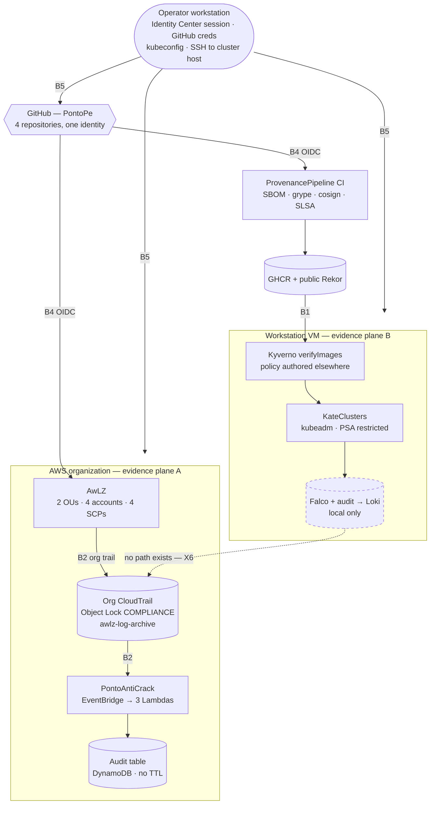

# Threat model — TrustStack (program level)

Written 2026-08-04. STRIDE, applied to the **seams between the four repositories**
rather than to their interiors.

Each repository already carries its own threat model, and those are the authority for
anything inside one layer:

| Layer | Model |
|---|---|
| Cloud governance | [AwLZ/docs/threat-model.md](../../AwLZ/docs/threat-model.md) |
| Artifact provenance | [ProvenancePipeline/docs/threat-model.md](../../ProvenancePipeline/docs/threat-model.md) |
| Runtime | [KateClusters/docs/threat-model.md](../../KateClusters/docs/threat-model.md) |
| Response | [PontoAntiCrack/docs/threat-model.md](../../PontoAntiCrack/docs/threat-model.md) |

**This document exists because a per-component model cannot see a threat that lives between
components.** Every one of the four is internally sound. Composed, they leave gaps that none
of them is wrong to omit — each is correctly scoped, and the gap is in the space no scope
claims. Five of the eight cross-boundary threats below are of exactly that shape: not a
control that failed, but a control nobody was assigned.

---

## 1. Scope

**In scope.** The trust boundaries *between* the four layers: what crosses them, who owns the
control on each side, and what happens when one side changes without the other knowing. Also
the assets shared by all four, which no single repository treats as its own.

**Out of scope.** Anything wholly inside one layer — those belong to the four models above,
and duplicating them here would create a second copy to keep in sync. AWS's own control-plane
integrity. Upstream CVEs in Kubernetes, Terraform, or the Debian package set.

**Deliberately reclaimed into scope:** the operator workstation. All four repositories place
it out of scope, individually with good reason. §6 (X8) is about what that sums to.

---

## 2. Data flow and trust boundaries

| # | Boundary | Crossed by | Owner, side A | Owner, side B |
|---|---|---|---|---|
| **B1** | ProvenancePipeline → KateClusters | An image pull, gated at admission | ProvenancePipeline (policy) | KateClusters (cluster) |
| **B2** | AwLZ → PontoAntiCrack | Org trail delivery + the lab account | AwLZ (trail, SCPs) | PontoAntiCrack (detections) |
| **B3** | PontoAntiCrack → AWS resources | A scoped IAM role performing a write | PontoAntiCrack | The target account |
| **B4** | GitHub → AWS *and* → Sigstore | OIDC token exchange, twice, for different purposes | GitHub | AwLZ / ProvenancePipeline |
| **B5** | Operator workstation → all of it | Interactive sessions of four different kinds | *Unowned* | *Unowned* |

B5 has no owner on either side. That is the finding, not an omission in the table.

---

## 3. Shared assets

Assets that belong to the program rather than to any one repository. Each is the kind of
thing a component model correctly treats as an input, and therefore never protects.

| Asset | Why it is program-level | If compromised |
|---|---|---|
| The GitHub account `PontoPe` | It is the trust anchor for **two unrelated capabilities**: applying Terraform to a live AWS organization, and signing container images as an identity a cluster enforces | Infrastructure takeover *and* the ability to mint images that pass admission — simultaneously |
| The operator workstation | Holds every credential that reaches any layer | All four layers at once, with no boundary between them |
| The org CloudTrail archive | AwLZ produces it; PontoAntiCrack consumes it; both treat it as given | The only forensic record for evidence plane A |
| The single operator | Every repository lists "one operator, no team to catch a mistake" as a constraint | No dual control exists on any boundary in the program |

---

## 4. STRIDE coverage, per boundary

The point of this table is the empty cells. A model that claims every category on every
boundary has not been thought about; the exclusions below are argued, and where a category
is genuinely uncovered it says **gap** rather than being left blank.

| Boundary | S | T | R | I | D | E |
|---|---|---|---|---|---|---|
| **B1** Provenance → cluster | X1 | X2 | *n/a¹* | *n/a²* | X3 | X1 |
| **B2** AwLZ → PAC | X5 | X4 | X4 | *n/a³* | X5 | X5 |
| **B3** PAC → resources | — | *see R2* | X7 | — | *see R2* | *see R1* |
| **B4** GitHub → AWS + Sigstore | X6 | X6 | **gap⁴** | — | — | X6 |
| **B5** Workstation → all | X8 | X8 | X8 | X8 | X8 | X8 |

1. **Repudiation, B1.** Every admission decision is written to the Kubernetes audit log and
   every signature to the public Rekor transparency log. Denying that an image was admitted
   requires forging two independent append-only records, one of which is not ours.
2. **Information disclosure, B1.** Everything crossing this boundary is public by
   construction — a public registry, a public transparency log, a public SBOM attestation.
   There is nothing on it to disclose.
3. **Information disclosure, B2.** Delivery is one-directional into an account whose bucket
   policy and key policy both deny cross-account read. AwLZ T4 owns this and closes it.
4. **Repudiation, B4 — real gap, accepted.** GitHub's audit log is the only record that a
   workflow file changed or that a repository's visibility flipped. It is retained by GitHub,
   under the same account whose compromise is the threat, and is not shipped anywhere this
   program controls. See X6 residual.

Categories marked `—` are covered inside a component model and are not restated here.

---

## 5. Threats that only exist between components

Numbered `X` for cross-boundary, to keep them distinct from the per-repo `T` and `R` series.

| # | Boundary | STRIDE | Threat | Likelihood | Impact | Control | Residual |
|---|---|---|---|---|---|---|---|
| **X1** | B1 | S, E | **The enforcement policy is deleted and both repositories stay green.** `verify-provenance` is authored in ProvenancePipeline and installed in KateClusters. ProvenancePipeline's CI tests policy *files*; KateClusters' CI tests cluster *manifests* and does not know the policy exists. `kubectl delete clusterpolicy verify-provenance` removes admission control while every gate in the program continues to pass. | Med | High | *None.* The deny-path tests run against the policy as a file, not against the live cluster. | **Open.** Closing it needs one check that asserts the live `ClusterPolicy` exists, is in `Enforce`, and carries the pinned identity — and it must live in the repository that owns the *cluster*, because that is the one whose CI would notice. |
| **X2** | B1 | T | **A repository setting, not code, breaks admission.** ProvenancePipeline's GitHub provenance step is gated on the repo being public, and that bundle is the only attestation Kyverno can discover on GHCR (ADR-009). Making the repository private denies every subsequently built image at admission. No commit, no review, no CI run is involved — a settings page. | Med | High | Documented as T9 in ProvenancePipeline and in `BLOCKED.md` B5. | **Open, deliberately.** The program-level addition is that the blast radius lands in a *different* repository than the one where the change is made, so ProvenancePipeline's own model understates it. E1 (pin cosign 2.x) closes the coupling. |
| **X3** | B1 | D | **The exclusion list ages against a cluster it does not own.** The policy excludes `kube-system`, `kyverno`, `calico-system`, `tigera-operator`, and applies the deny-all-unsigned rule **opt-in by namespace label**. Which namespaces exist is KateClusters' decision; which are excluded is ProvenancePipeline's. A namespace added on one side is unprotected until someone remembers the other. | High | Med | Exclusions are enumerated and argued inline in `policies/kyverno/verify-images.yaml`; a test asserts the namespace gate still holds. | **Open.** The test proves the gate works, not that the list is still correct. An unlabelled namespace runs third-party images freely and nothing reports it. |
| **X4** | B2 | T, R | **Asymmetric retention: an audit record outlives its evidence.** PontoAntiCrack's audit table has no TTL, by design — it is the rollback source. AwLZ expires Config history at 90 days and the CloudWatch tail at 14, and Object Lock COMPLIANCE holds for 30. After 90 days an audit record says a resource was auto-changed, and the CloudTrail evidence justifying it may be gone. | High | Med | Object Lock protects the archive within its window; audit records are immutable within theirs. | **Open.** During an incident review the two records disagree by construction, and the disagreement looks like tampering rather than retention policy. Either the retentions align or the mismatch is stated where an investigator will read it. **The second is cheaper and is what this paragraph is.** |
| **X5** | B2 | S, D, E | **PontoAntiCrack's protection is a naming convention enforced in another repository.** AwLZ's SCP protects `pac-*` resources (PAC R3's control). A PAC resource created without the prefix is silently unprotected, and AwLZ has no test that PAC's resources match the pattern its policy assumes. | Med | High | The SCP exists and is probed from inside a member account. | **Open, and already realised once in the mirror image:** `awlz-config-aggregator` matched the protected `awlz-*` prefix and the guardrails blocked their own deployment. Prefix-based policy fails in both directions — over-matching breaks deployment, under-matching removes protection — and only the first one is loud. |
| **X6** | B4 | S, T, E | **One GitHub account is simultaneously infrastructure takeover and a signing capability.** AwLZ trusts GitHub OIDC to apply Terraform to a live organization. ProvenancePipeline trusts GitHub OIDC as the Sigstore identity a cluster enforces. Each model is correct on its own — AwLZ T1 conditions on an exact `sub`, ProvenancePipeline T4 observes there is no key to steal. **Neither can see that both trust the same account, so its compromise breaks every layer at once.** | Low | **Critical** | 2FA enforced; branch protection on `main`; AwLZ's apply is gated behind a protected environment; the OIDC `sub` embeds immutable numeric owner and repo IDs, so a rename cannot silently transfer trust. | **Partly open, and asymmetric.** Terraform apply is gated on a protected environment; **image signing is gated on a push to `main` and nothing else.** The weaker of the two paths is the one that mints artifacts a cluster is configured to trust. Aligning them means gating the release workflow on the same environment approval. |
| **X7** | B3 | R | **Two independent alert paths with no correlation.** AwLZ's break-glass alarm and PontoAntiCrack's circuit breaker both notify, through different topics, with no shared identifier. An incident that trips both produces two unlinked stories. | Low | Med | Both alerts carry account context. | **Accepted.** At one operator and this volume, correlation is a human reading two messages. It stops being acceptable the moment a second responder exists. |
| **X8** | B5 | all six | **Four "out of scope" declarations compose into one unowned asset.** Every repository excludes operator endpoint security, and each is right to. The workstation holds the Identity Center session, the GitHub credentials, the kubeconfig, and the SSH key to the cluster host. It is the only asset from which all four layers are reachable, and the only one no model claims. | Low | **Critical** | Hardware MFA on two devices for the management root; SSH key-only; no static AWS access keys anywhere. | **Open, and stated here precisely because the composition is invisible from inside any single repository.** Nothing in the program detects use of the workstation's credentials as anomalous — every layer treats them as the legitimate operator by construction. |

---

## 6. The finding that has no threat ID: two disjoint evidence planes

AwLZ and PontoAntiCrack share the org CloudTrail. KateClusters and ProvenancePipeline share
nothing with them.

Falco events and the Kubernetes audit log terminate in a **local** Loki on the workstation
VM. Nothing forwards them to AWS, and nothing in AWS knows the cluster exists. The dotted
edge in §2 is not a link that is broken — it is a link that was never built.

The consequence is not that either plane is weak. Both work, and both have measured evidence.
It is that **no query spans them.** An attacker who obtains the operator's credentials and
moves between the AWS organization and the cluster produces two unrelated halves of a story,
in two systems, with no shared identifier, no shared clock discipline, and no single place a
responder would look.

This is stated as a design consequence rather than a defect: shipping cluster telemetry into
AWS would add cost against a USD 20/month ceiling, and cross the one boundary the program
deliberately keeps free of paid cloud. **The trade is defensible. Making it silently is
not** — which is the only reason this section exists.

---

## 7. Accepted risks

Consolidated from all four repositories, because a risk accepted in one and unknown in the
others is not really accepted. Each entry: what is open, why it was not closed, what closing
it costs, and who decided.

| Risk | Origin | Why it stands | What closes it |
|---|---|---|---|
| **SLSA Build L2, not L3** | ProvenancePipeline | The provenance predicate is assembled in the same job that builds the image, so anything compromising that job can write its own provenance | `slsa-github-generator` in an isolated context. Stated in the strong form in the README rather than claimed as "SLSA compliant" |
| **T9 / X2 — attestation gated on repo visibility** | ProvenancePipeline | GitHub's bundle is the only one Kyverno can discover on GHCR; ADR-005's original assumption was backwards and ADR-009 records the correction with the original left visible | E1: pin cosign 2.x and enforce on cosign's own attestation |
| **X1 — nothing asserts the live policy still exists** | This document | Newly identified; not previously owned by either repository | One live-cluster check in KateClusters' CI |
| **No dead-man's-switch on the detection path** | PontoAntiCrack R3 | A deleted EventBridge rule produces no metric, so the error alarm never fires. The largest open gap in that model | A heartbeat event on a schedule, alarmed on absence |
| **Fixture provenance** | PontoAntiCrack R4 | Two of seventeen fixtures remain documentation-derived; the marker is enforced by a test that fails if it stops being accurate | Detonating the remaining two techniques |
| **T2 detection is one rule, not two** | KateClusters | The outbound rule cannot fire when egress default-deny succeeds — prevention and detection are not independent there, and the CPU-anomaly panel named in the original table does not exist | A CPU signal, or accepting that a process rename defeats it |
| **NetworkPolicy is namespaced, not cluster-wide** | KateClusters | A fresh namespace is fully open until policy is applied | A Calico `GlobalNetworkPolicy`, if arbitrary namespace creation enters scope |
| **~25 min detection blind window** | KateClusters | `[15m]` query window plus `for: 10m` means the last heartbeat must age out before the timer starts. Measured at 24m36s, not the ~15 min originally documented | Shorter window, at the cost of false positives on transient gaps |
| **Management account root is a standing credential** | AwLZ T9 | Member accounts have no root credentials at all; the management account must keep one. Hardware MFA on two devices, password stored separately | Nothing — AWS requires it. Bounded, not closed |
| **X6 — signing gate weaker than the apply gate** | This document | Newly identified from composing AwLZ T1 with ProvenancePipeline T4 | Gate the release workflow on the same protected environment as Terraform apply |
| **X8 — the workstation** | This document | Four correct exclusions summing to one uncovered asset | Out of proportion to a single-operator lab; named so it is a decision rather than an oversight |
| **No multi-tenant isolation** | KateClusters | Single node, lab cluster, claimed nowhere | Not a goal |

---

## 8. What this model does not prove

- It does not prove the four layers are individually secure. That is what the four component
  models are for, and they are the authority.
- It does not prove the cross-boundary controls **work**, because five of the eight threats
  above have no control yet. X1, X3, X4, X5 and X8 are stated, not mitigated.
- Nothing here has been exercised end-to-end across a boundary. The per-layer evidence is
  real and measured; **cross-layer evidence does not exist.** The honest next artifact is a
  single exercise that crosses B1 and B2 in one run.
- It says nothing about AWS's control plane, upstream CVEs, or the correctness of Sigstore's
  own trust root.

---

## 9. Revisit conditions

Not a date — a list of changes that invalidate something above.

- A **fifth repository**, or any new coupling between two existing ones. Every threat here
  came from a coupling.
- A **second operator.** X7 becomes unacceptable immediately and X8's likelihood changes
  shape rather than degree.
- **KateClusters gains a namespace**, which ages X3 on the day it happens.
- **Either repository's visibility changes** — X2.
- **The release workflow gains an approval gate**, which closes half of X6 and should be
  recorded rather than absorbed.
- **Retention changes on either side of B2** — X4 is a comparison, so moving either number
  moves the finding.

---

_Program model. Component models remain the authority inside their own scope; where this
document and a component model disagree about a control's interior, the component model is
right and this one has drifted._
